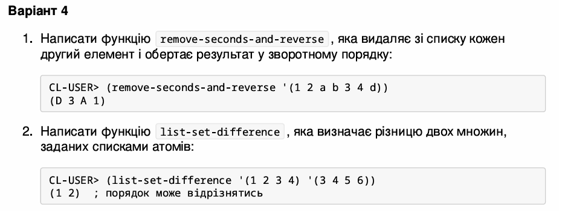

<p align="center"><b>МОНУ НТУУ КПІ ім. Ігоря Сікорського ФПМ СПіСКС</b></p>
<p align="center">
<b>Звіт з лабораторної роботи 2</b><br/>
"Рекурсія"<br/>
дисципліни "Вступ до функціонального програмування"
</p>
<p align="right"><b>Студентка</b>: Ідолова А.П. група КВ-33</p>
<p align="right"><b>Рік</b>: 2026</p>

## Загальне завдання

Реалізуйте дві рекурсивні функції, що виконують деякі дії з вхідним(и) списком(-ами), за
можливості/необхідності використовуючи різні види рекурсії. Функції, які необхідно
реалізувати, задаються варіантом (п. 2.1.1). Вимоги до функцій:
1. Зміна списку згідно із завданням має відбуватись за рахунок конструювання нового
списку, а не зміни наявного (вхідного).
2. Не допускається використання функцій вищого порядку чи стандартних функцій
для роботи зі списками, що не наведені в четвертому розділі навчального
посібника.
3. Реалізована функція не має бути функцією вищого порядку, тобто приймати функції
в якості аргументів.
4. Не допускається використання псевдофункцій (деструктивного підходу).
5. Не допускається використання циклів.
Кожна реалізована функція має бути протестована для різних тестових наборів. Тести
мають бути оформленні у вигляді модульних тестів.
   
## Варіант 4
<p align="center">

</p>

## Лістинг функції remove-seconds-and-reverse
```lisp
(defun remove-seconds-and-reverse-aux (lst res)
  (cond
    ((null lst) res)
    ((null (cdr lst)) (cons (car lst) res))
    (t (remove-seconds-and-reverse-aux  (cdr (cdr lst)) (cons (car lst) res)))))

(defun remove-seconds-and-reverse (lst)
  (remove-seconds-and-reverse-aux lst nil))
```

### Тестові набори та утиліти
```lisp
(defun check-remove (name input expected)
  (format t "~:[FAILED~;passed~]... ~a~%"
          (equal (remove-seconds-and-reverse input) expected)
          name))

(defun test-remove-seconds-and-reverse ()
  (check-remove "test 1" '(1 2 a b 3 4 d) '(d 3 a 1))
  (check-remove "test 2" nil nil)-
  (check-remove "test 3" '(1) '(1))
  (check-remove "test 4" '(a b c d) '(c a))
  (check-remove "test 5" '(1 2) '(1)))
```
### Тестування
```lisp
‌‌CL-USER> (test-remove-seconds-and-reverse)
 
NIL

Standard output:
* passed... test 1
passed... test 2
passed... test 3
passed... test 4
passed... test 5

```
## Лістинг функції list-set-difference 
```lisp
(defun is-in-list (elem lst)
  (cond
    ((null lst) nil)
    ((eql (car lst) elem) t)
    (t (is-in-list elem (cdr lst)))))

(defun list-set-difference (set1 set2)
  (cond
    ((null set1) nil)
    ((is-in-list (car set1) set2)
     (list-set-difference (cdr set1) set2))
    (t
     (cons (car set1) (list-set-difference (cdr set1) set2)))))
```
### Тестові набори та утиліти
```lisp
(defun check-difference (name set1 set2 expected)
  (format t "~:[FAILED~;passed~]... ~a~%"
          (equal (list-set-difference set1 set2) expected)
          name))

(defun test-list-set-difference ()
  (check-difference "test 1" '(1 2 3 4) '(3 4 5 6) '(1 2))

  (check-difference "test 2" '(1 2) '(1 2) nil)

  (check-difference "test 3" nil '(1 2) nil)

  (check-difference "test 4" '(1 2) '(3 4) '(1 2)))
```
### Тестування
```lisp
‌‌‌‌CL-USER> (test-list-set-difference)
 
NIL

Standard output:
passed... test 1
passed... test 2
passed... test 3
passed... test 4

```